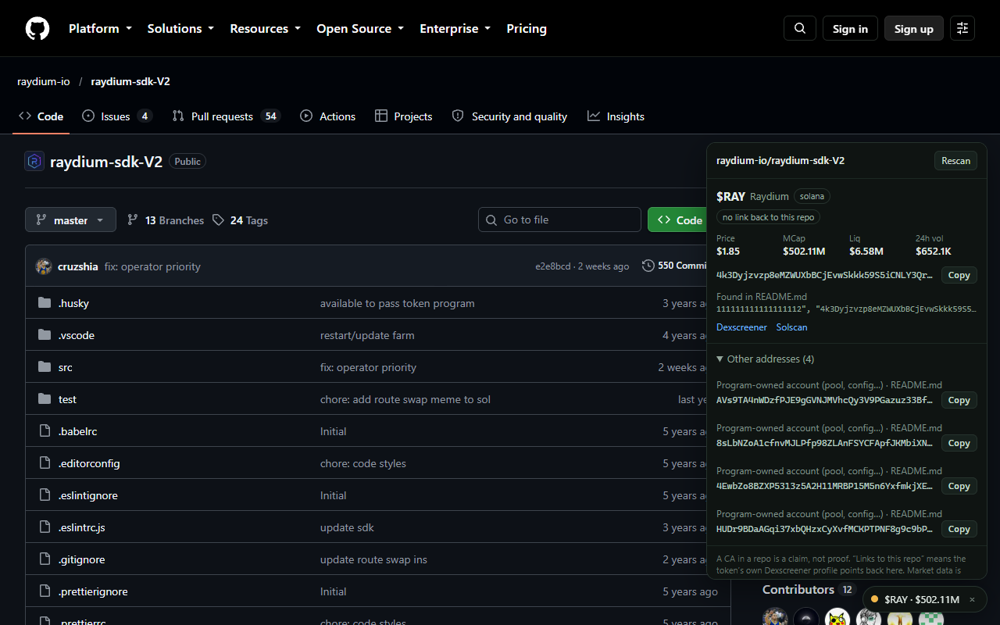

# gitscan

A browser extension that answers one question on any GitHub repo page: **is the coin in this repo real?**

It reads the repo's description, README and a few root config files, finds token contract addresses
(Solana and EVM), and checks each one: is it a live, traded token, a bare mint with no market yet, or just a
wallet, program or pool account? A small badge in the bottom-right corner shows the answer.



## Install

gitscan is not on the Chrome Web Store yet, so you load it from a folder. Works in Chrome, Brave and Edge.

1. Download this repo (green **Code** button → **Download ZIP**) and unzip it somewhere permanent.
2. Open `chrome://extensions` (or `brave://extensions`, `edge://extensions`) and turn on **Developer mode**.
3. Click **Load unpacked** and pick the folder that contains `manifest.json`.
4. Open any GitHub repo. The badge appears after a second or two.

Optional: in the extension's options, paste a fine-grained GitHub token with **no permissions** (public read-only).
That lifts GitHub's rate limit from about 60 to 5,000 requests an hour. It stays on your device and is only sent to
`api.github.com`.

## What the badge means

| Badge | Meaning |
|---|---|
| amber lamp | an address was found: a live, traded token (name, price, market cap, liquidity, volume) or a bare Solana mint with no market yet, but nothing confirms it belongs to this repo |
| green lamp **✓** | a token was found **and** its own Dexscreener profile links back to this repo |
| grey lamp | no contract address found |

A contract address in a README is a claim, not proof. The lamp only turns green, with a tick, when the token's
profile points back at the same repo, so the repo and the coin agree. It does not mean the code is safe or the token is a good idea.
Market data is informational, not financial advice.

## How it works

- `src/content.js` runs on github.com, reads the repo name from GitHub's own meta tag, and re-checks on navigation.
- `src/background.js` runs the scan (cached for 30 minutes) using `src/core.js`:
  1. GitHub API for the description and root file list; the README and a few config files come from raw.githubusercontent.com.
  2. `src/extract.js` finds Solana (base58 that decodes to 32 bytes) and EVM (`0x` + 40 hex) addresses and skips
     well-known ones (USDC, wrapped SOL, system programs).
  3. Dexscreener says whether an address is a traded token and whether its profile links back to this repo.
  4. For Solana addresses with no market, the network says whether it is a token mint, a wallet, a program or a pool account.

Everything fetched from third parties is treated as untrusted: bounded in size, time-limited, type-checked, and
rendered as text only. Links only ever point to dexscreener.com and solscan.io.

## Privacy

No analytics, no server, no account. The only third parties contacted are GitHub, Dexscreener and PublicNode
(Solana RPC). See [PRIVACY.md](PRIVACY.md).

## Develop

```
node --test test/extract.test.js test/hardening.test.js
node test/live.js owner/repo [githubToken]    # live GitHub + Dexscreener + RPC check
node tools/pack.js                            # builds dist/gitscan-<version>.zip (byte-reproducible)
```

`test/harness.html?repo=owner/name` renders the content script with a stubbed `chrome` API when served over http.
`tools/screenshots.js` and `tools/crops.js` need `puppeteer-core` and a Chromium build.

## Token

- Ticker: $GITSCAN
- Chain: Solana
- Contract address: `6fCn2zY8vYbnRqHe57r3JmER2PXeAmX41Cpb5QQRpump`

gitscan reads this address from this README, so you can check it yourself: open this repo with the extension
installed. Not financial advice. Do your own research.

## Links

- X: [@gitcascan](https://x.com/gitcascan)

## License

MIT, see [LICENSE](LICENSE).
